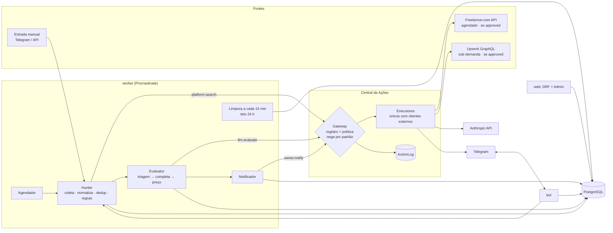

# Freelance Agent — Módulo de Descoberta e Avaliação de Oportunidades

**Status:** v2.4. Arquitetura v2 fechada; P9 aprovado com ajustes; D1 a D4 decididos (D4 temporário); **Fase 1 liberada** · **Data:** 2026-11-18 · **Escopo:** primeiro módulo do Freelance Agent
**Revisão:** ver [`docs/reviews/2026-11-18-revisao-arquitetura.md`](../../reviews/2026-11-18-revisao-arquitetura.md) para problemas, riscos, Fase 0 e critérios de prontidão.

**O que mudou do v1 para o v2:**
- Central de Ações: gateway único para toda ação externa (seção 5.5).
- Aprovação vinculada ao conteúdo, especificada (seção 5.6).
- Conformidade e retenção por fonte, com dados de terceiros por no máximo 24 h (seções 3 e 6).
- Preço v2 com taxas e custos (seção 8.1).
- Preços e configuração dos modelos Anthropic verificados (seção 8.2).
- Requisitos do sandbox futuro e segredos por container (seções 5.2 e 5.7).

**O que mudou da v2 para a v2.1** (revisão pontual, sem redesenho):
1. **Retenção:** limite efetivo de **no máximo 24 h**, já contando atrasos da limpeza, backups, logs e mensagens do Telegram. A inconsistência "24 h / 25 h" foi eliminada (seção 6.1).
2. **Tributação:** o parâmetro de imposto passa a ser uma **estimativa configurável**, explicitamente sem valor de apuração tributária (seção 8.1).
3. **Aprovação:** casos de teste individuais para os 8 invariantes do `ApprovalRequest` (seção 5.6.1).
4. **ActionLog:** imutabilidade garantida no banco, com papéis separados, permissões e *triggers*, além de detecção de adulteração (seção 5.8).
5. **Fase inicial:** registrada a decisão do usuário de começar só com a entrada manual (seção 4).

**O que mudou da v2.1 para a v2.2** (fechamento, sem redesenho):
1. **Retenção:** métrica única `content_max_age_hours`. Alerta (22 h), contenção (23 h), teto (24 h), critério de sucesso e testes usam essa mesma métrica (seção 6.1).
2. **Aprovação:** oito casos de teste individuais, CT-AP-1 a CT-AP-8, um por invariante, cada um ligado aos seus subcasos AP-01 a AP-22 (seção 5.6.1).
3. **ActionLog:** explicitado como *append-only* (seção 5.8; mecanismo inalterado desde a v2.1).
4. **Tributação** e **início com entrada manual:** confirmados sem mudança de conteúdo (seções 8.1.1 e 4).
5. **Histórico de versões e decisões** consolidado (seção 18).

**O que mudou da v2.2 para a v2.3** (aprovações do usuário, sem redesenho):
1. **`owner.notify` e `platform.oauth_refresh` aprovadas** pelo usuário em 18/11/2026 e registradas no `AUTHORIZATION.md` (nova seção "Ações de infraestrutura") e no registro de ações do código, com os limites aprovados. A ressalva explícita fica registrada: elas **não autorizam** envio de propostas, aceitação de contratos, entrega de projetos nem recebimento de pagamentos.
2. **Núcleo de autorização implementado** (a pedido do usuário, antes da Fase 1): registro, decisão de política, lógica pura do `ApprovalRequest`, gateway com auditoria em memória e testes. É Python puro, sem Django, banco ou rede (seção 5.5.1).
3. A **lógica pura** do `ApprovalRequest` foi antecipada. A persistência e a atomicidade no PostgreSQL continuam para quando existir a primeira ação de nível "Minha aprovação" (seção 5.6).

**O que mudou da v2.3 para a v2.4** (aprovação do P9 com ajustes do usuário):
1. `platform.search` e `platform.oauth_refresh` **sem executor** até os conectores entrarem no escopo. A lista de ações executáveis é fechada em `llm.evaluate` e `owner.notify` (testes AZ-16 e AZ-17).
2. **F4 obrigatório para a conclusão do cálculo de preço.** Sem F4, nenhum preço é calculado nem apresentado (seção 8.1).
3. **AP-12 é requisito obrigatório** antes de habilitar o módulo de propostas (seção 5.6.1).
4. **D3:** máquina do usuário com Docker Compose nas Fases 1 a 4; GitHub privado; GitHub Actions com PostgreSQL 17; VPS reavaliado antes da Fase 5.
5. **D4:** alternativa A aprovada **temporariamente**, só enquanto houver apenas entrada manual; **não é herdada** pela Fase 5 (seção 6.1).
6. Execução por subagentes com arquivos protegidos e portões por tarefa (plano P9, "Regras de execução por subagentes").

---

## 1. Intenção e porquê

O Freelance Agent é uma operação de freelancer **parcialmente autônoma** para encontrar, avaliar e, futuramente, executar projetos de desenvolvimento backend. O sistema faz o trabalho repetitivo (vasculhar plataformas, ler descrições, descartar o que não serve, resumir e precificar o que vale a pena) e o humano decide.

Este documento cobre **apenas o primeiro módulo**: descobrir oportunidades e avaliá-las com o Claude, entregando as boas no Telegram com justificativa e preço sugerido. Proposta, negociação e execução ficam para depois, mas o modelo de dados e a Central de Ações já preveem esses passos para não exigir retrabalho.

### 1.1 Política de autorização: regra global e inviolável

O [`AUTHORIZATION.md`](../../../AUTHORIZATION.md) vale para **todos os módulos, presentes e futuros**. Na prática:
- A política é aplicada **em código** por um único ponto, a Central de Ações (seção 5.5). Nenhum módulo executa ação externa por fora dela.
- **Nenhuma configuração** (variável de ambiente, Admin, banco, prompt) consegue afrouxar um nível. Mudar a política significa mudar o `AUTHORIZATION.md` **e** o registro de ações no código, no mesmo commit. Um teste compara os dois.
- A Central **nega por padrão**: ação desconhecida é negada.

| Ação (AUTHORIZATION.md) | Nível | Neste módulo |
|---|---|---|
| Analisar oportunidades | Automática | **Implementada** |
| Classificar projetos | Automática | **Implementada** |
| Calcular preço | Automática | **Implementada** |
| Escrever propostas | Automática | Próximo módulo |
| Enviar proposta | Minha aprovação | Sem executor; a Central nega |
| Aceitar contrato | Minha aprovação | Sem executor; a Central nega |
| Desenvolver projeto contratado | Automática, em ambiente isolado | Futuro (requisitos na seção 5.7) |
| Entregar ao cliente | Minha aprovação | Sem executor; a Central nega |
| Receber pagamentos | Eu | **Nunca**; a Central nega sempre |

## 2. Objetivos, não-objetivos e anti-objetivos

### Objetivos
1. Coletar oportunidades de backend em **fontes com API oficial, gratuita e com uso automatizado permitido por escrito**, além da entrada manual.
2. Normalizar tudo num formato único e deduplicar.
3. Descartar o que é obviamente inadequado **sem gastar tokens** (filtro por regras).
4. Avaliar o restante com o Claude: nota, recomendação, resumo, alertas, perguntas ao cliente e estimativa de horas. Tudo **explicado**.
5. **Calcular o preço sugerido** com o detalhamento de taxas e custos e o valor **líquido** estimado.
6. Notificar no Telegram apenas o que passa do limiar, com botões para registrar a decisão.
7. Guardar o feedback para medir a qualidade da avaliação.
8. Expor tudo via API REST (DRF) e Django Admin.
9. Executar **toda** ação externa pela Central de Ações, com registro auditável.

### Não-objetivos (fora deste módulo)
- Escrever e enviar propostas; aceitar contratos; entregar; executar projetos.
- Implementar o `ApprovalRequest`: está especificado (seção 5.6), mas nenhuma ação deste módulo precisa dele, e a Central nega esse nível enquanto ele não existir.
- Implementar o sandbox de desenvolvimento (só os requisitos, seção 5.7).
- **Automação de navegador** e scraping de HTML.
- Interface web própria, multiusuário, aprendizado automático a partir do feedback.

### Anti-objetivos (falhas mesmo que "funcione")
- **Violar termos de uso** de qualquer plataforma.
- **Agir além da política**, mesmo que o resultado seja bom.
- **Tocar em pagamentos**: o sistema nunca integra, automatiza ou guarda credenciais de recebimento.
- **Spam de notificações.**
- **Custo de API descontrolado.**
- **Avaliação opaca** ou **preço que esconde custos**.

## 3. Restrições

| Restrição | Origem | Impacto no design |
|---|---|---|
| Stack: Python, DRF, PostgreSQL, Docker, Anthropic API, Telegram | Pedido | Base técnica |
| Sem automação de navegador | Pedido | Só APIs oficiais e entrada manual |
| Fontes só via API gratuita; se não houver, só entrada manual | Decisão do usuário | Seção 4 |
| **Freelancer.com:** o User Agreement (seção 33) proíbe acesso automatizado, **inclusive pela API**, sem permissão expressa por escrito. Os API Terms proíbem copiar ou armazenar dados, exceto em cache atualizado ao menos a cada 24 h e criptografado | Termos do Freelancer.com | Coleta agendada **só com permissão por escrito**; nenhuma chamada automatizada antes disso; retenção ≤ 24 h |
| **Upwork:** chave de API com aprovação manual, uso pessoal/interno. Os API & MCP Terms permitem buscar só para tarefa **específica e dirigida pelo usuário** (4.1), sem monitoramento contínuo; exigem coletar o mínimo de dados (4.2); limitam o cache a **24 h** (8.3); proíbem usar conteúdo da Upwork para treinar, ajustar, *retrieval-augment*, **avaliar ou fazer benchmark** de modelos de IA (5.3) | Termos da Upwork | Só sob demanda; retenção ≤ 24 h; **nunca** no golden set ou em calibração; conector só liga após esclarecimento por escrito sobre inferência por LLM de terceiros |
| Anthropic API cobrada por token, com raciocínio adaptativo cobrado como saída | Documentação da Anthropic | Filtro por regras, triagem barata, `effort` explícito, reserva de orçamento |
| Workana e 99Freelas sem API pública | Pesquisa | Fora do escopo |

## 4. Abordagens consideradas

| | Abordagem | Decisão |
|---|---|---|
| A | **Entrada manual** (Telegram/API) | **Sempre ativa** e a única garantida sem depender de terceiros |
| **B** | **APIs oficiais** (Freelancer.com, Upwork) | **Escolhida**, condicionada à conformidade de cada fonte |
| C | Scraping de HTML | Descartada |

**Regra do usuário:** "Se não for paga, segue com B; se for, vai de A somente." As APIs são gratuitas, mas a revisão mostrou que **gratuita não quer dizer permitida para uso automatizado**. Por isso cada fonte tem um **status de conformidade**, e a Central de Ações só deixa buscar em fonte `approved`:
- **Freelancer.com:** coleta agendada após permissão por escrito.
- **Upwork:** só sob demanda (`/upwork <termos>`), após a chave aprovada **e** o esclarecimento por escrito sobre inferência por LLM.
- **Se nenhuma for liberada**, o sistema roda com a opção A. A arquitetura não muda, porque os conectores são plugáveis.

> **Decisão do usuário (18/11/2026):** o sistema **começa só com a entrada manual** (Telegram `/avaliar` e `POST /api/opportunities/manual/`), **sem depender** da aprovação das APIs do Freelancer.com e da Upwork. Os conectores dessas plataformas (Fases 5 e 6) só são ativados quando a respectiva fonte tiver `compliance_status = approved`. A demora ou a negativa delas não bloqueia nem atrasa as Fases 1 a 4.

## 5. Arquitetura

### 5.1 Visão geral



### 5.2 Processos, segredos e rede

Uma imagem, três comandos contínuos e um comando pontual de migração, mais o banco. **Cada container recebe só os segredos de que precisa.**

| Serviço | Comando | Papel no banco | Segredos | Rede |
|---|---|---|---|---|
| `db` | `postgres:17` | — | senha do superusuário (só no `db`) | Só rede interna |
| `migrate` | `python -m app.main migrate` (roda e termina) | `fa_owner` | credenciais de `fa_owner` | Só rede interna |
| `web` | `python -m app.main web` | `fa_app` | credenciais de `fa_app`, `DJANGO_SECRET_KEY` | Publicado **só em `127.0.0.1`**; acesso por túnel SSH/VPN |
| `worker` | `python -m app.main worker` | `fa_app` | credenciais de `fa_app`, `ANTHROPIC_API_KEY`, credenciais das plataformas, `FIELD_ENCRYPTION_KEY` | Saída para Anthropic, plataformas e Telegram |
| `bot` | `python -m app.main bot` | `fa_app` | credenciais de `fa_app`, `TELEGRAM_BOT_TOKEN` | Saída para Telegram |

**Dois papéis no PostgreSQL** (detalhes na seção 5.8):
- `fa_owner` é dono do schema e só é usado pelo `migrate`.
- `fa_app` é o papel de execução, com permissões mínimas.

Nenhum container de execução recebe as credenciais de `fa_owner` nem do superusuário.

Regras fixas:
- **Nenhum container monta `docker.sock`**, roda privilegiado ou monta diretórios do host além do `PROFILE.md` (somente leitura).
- Containers rodam como usuário não-root.
- `DEBUG=False` e `ALLOWED_HOSTS` restrito fora do desenvolvimento.

O bot também emite ações externas (responder ao dono). Para isso, ele usa a Central de Ações com o executor de Telegram.

**Fila: Procrastinate** (mantido). Fila sobre o PostgreSQL, com integração com Django e tarefas periódicas. O uso fica restrito a `app/tasks.py`, para que trocar por Celery afete um módulo só.
**Telegram em long polling** (mantido).

### 5.3 Estrutura do repositório

Estrutura proposta pelo usuário. **(+)** marca acréscimos; **(futuro)** marca itens reservados que não são criados neste módulo. `app/` é **um único app Django**.

```
freelance-agent/
├── app/
│   ├── agents/
│   │   ├── hunter.py               # Coleta, normalização, dedup, regras; extração de texto livre
│   │   ├── evaluator.py            # Triagem + completa; final_score; chama pricing
│   │   └── proposal_writer.py      # (futuro)
│   ├── services/
│   │   ├── claude.py               # Monta requisições e interpreta respostas; chama a Central
│   │   ├── telegram.py             # Formatação, handlers; envio via Central
│   │   ├── opportunities.py        # Upsert, dedup, estados, feedback, limpeza por TTL
│   │   ├── profile.py          (+) # PROFILE.md: leitura, validação, skills, hash
│   │   ├── pricing.py          (+) # Preço v2 (função pura)
│   │   └── budget.py           (+) # Reserva e contabilização do gasto de LLM
│   ├── actions/                (+) # CENTRAL DE AÇÕES (seção 5.5)
│   │   ├── registry.py             # Ações, níveis, linha do AUTHORIZATION.md
│   │   ├── gateway.py              # execute(): política, aprovação, auditoria
│   │   └── executors/              # ÚNICOS módulos que importam anthropic/httpx/telegram
│   │       ├── anthropic.py
│   │       ├── telegram.py
│   │       ├── freelancer.py
│   │       └── upwork.py
│   ├── connectors/             (+) # Traduzem respostas das APIs para OpportunityDTO (sem rede)
│   │   ├── base.py
│   │   ├── freelancer.py
│   │   ├── upwork.py
│   │   └── manual.py
│   ├── models/
│   │   ├── opportunity.py          # Opportunity, Evaluation, Feedback, TelegramMessage
│   │   ├── source.py           (+) # Source, SearchQuery, OAuthCredential, FeeSchedule
│   │   ├── settings.py         (+) # Profile (critérios operacionais e custos)
│   │   ├── actions.py          (+) # ActionLog  (ApprovalRequest: futuro)
│   │   └── pipeline.py         (+) # PipelineRun
│   ├── api/  tasks.py  admin.py  migrations/  config/   (+)
│   └── main.py
├── prompts/  hunter.md  evaluator.md  proposal.md (futuro)
├── tests/  fixtures/ (+)  architecture/ (+)
├── docs/  adr/ (+)  reviews/ (+)  threat-model.md (+)
├── Dockerfile (+)  docker-compose.yml  pyproject.toml (+)  .env.example (+)  manage.py (+)
├── PROFILE.md
├── AUTHORIZATION.md
└── README.md
```

**Mudança em relação ao v1:** os conectores deixaram de fazer chamadas de rede. Eles só **montam a requisição** e **traduzem a resposta**. Quem chama a API é o executor, via Central. Assim, testar o conector continua sendo testar uma função pura com *fixtures*.

### 5.4 Interface dos conectores

```python
class SourceConnector(Protocol):
    kind: str  # "freelancer" | "upwork" | "manual"
    mode: Literal["scheduled", "on_demand"]

    def build_search(self, spec: SearchSpec) -> ExternalRequest: ...
    def parse_search(self, response: dict) -> list[OpportunityDTO]: ...
```

O agendador só considera fontes `scheduled` **e** `approved`. A Upwork é `on_demand` por definição no código.

### 5.5 Central de Ações (requisitos 1 e 2)

**Toda ação externa** passa por `app.actions.gateway.execute(action, target, payload, *, approval_id=None)`.

**Registro** (`registry.py`, código, imutável em tempo de execução):

| Ação | Linha do AUTHORIZATION.md | Nível | Executor neste módulo |
|---|---|---|---|
| `platform.search` | Analisar oportunidades | Automática | **Não**: sem executor até os conectores entrarem no escopo (AZ-16) |
| `platform.oauth_refresh` | Ações de infraestrutura: `platform.oauth_refresh` (aprovada em 18/11/2026). Só renova, com escopos iguais ou menores que os concedidos, e o payload aceita apenas `provider` e `requested_scopes` | Automática | **Não**: sem executor até os conectores entrarem no escopo (AZ-16) |
| `llm.evaluate` | Analisar / Classificar / Calcular preço | Automática | Sim |
| `owner.notify` | Ações de infraestrutura: `owner.notify` (aprovada em 18/11/2026). Destinatário **exclusivamente** o chat privado do dono | Automática | Sim |
| `proposal.write` | Escrever propostas | Automática | Não |
| `proposal.submit` | Enviar proposta | Minha aprovação | Não |
| `contract.accept` | Aceitar contrato | Minha aprovação | Não |
| `project.develop` | Desenvolver projeto contratado | Automática, isolado | Não |
| `delivery.send` | Entregar ao cliente | Minha aprovação | Não |
| `payment.*` | Receber pagamentos | Eu | **Proibido existir** |

**Algoritmo do gateway:**
1. Ação fora do registro → **nega**.
2. Nível "Eu" → **nega sempre**.
3. Nível "Minha aprovação" → exige um `ApprovalRequest` válido (seção 5.6). Enquanto o modelo não existir, **nega**.
4. Nível "isolado" → exige contexto de sandbox (seção 5.7). Neste módulo, **nega**.
5. `platform.search` → exige fonte `approved` e respeita o modo (`on_demand` só com gatilho do usuário).
6. `llm.evaluate` → exige reserva de orçamento aprovada (seção 8.2).
7. Executa pelo executor registrado e grava no `ActionLog`: ação, alvo, `payload_hash`, decisão (`allowed` / `denied` + motivo), `approval_id`, resultado, duração e erro. A tabela é **só de inserção**, garantida no banco (seção 5.8).

**Garantias verificáveis:**
- **Teste de arquitetura** (`import-linter`): só `app.actions.executors.*` pode importar `anthropic`, `httpx`/`requests` e `telegram`. Violação quebra o CI.
- **Teste de consistência:** lê a tabela do `AUTHORIZATION.md` e compara com o registro.
- **Teste de negação:** para cada ação com nível diferente de "Automática", chamar o gateway sem os requisitos resulta em `denied` e em linha no `ActionLog`.
- **O LLM não escolhe ações.** O *tool use* serve só para a saída estruturada; nada da resposta do modelo vira chamada ao gateway.

#### 5.5.1 Implementação atual (v2.3)

Implementado a pedido do usuário, em Python puro, sem Django, banco ou rede:

| Arquivo | Conteúdo |
|---|---|
| `app/actions/registry.py` | `Level`, `ActionSpec`, `REGISTRY` imutável (`MappingProxyType` + *dataclasses* congeladas), prefixo reservado `payment.` |
| `app/actions/policy.py` | `authorize()`: nega por padrão, regras por nível e por ação, falha fechada com payload inválido |
| `app/actions/approval.py` | Payload canônico, hash, criação, mensagem, decisões do dono, expiração, substituição, verificação na execução, uso único |
| `app/actions/gateway.py` | `execute()`: autoriza, chama o executor, consome a aprovação só em caso de sucesso, devolve a auditoria |
| `app/actions/audit.py` | `AuditEntry` (sem conteúdo, só hash). A gravação no `ActionLog` fica para a Fase 2 |
| `app/actions/authorization_md.py` | Leitura das tabelas do `AUTHORIZATION.md`, só para o teste de consistência |

**Testes de autorização** (`tests/actions/test_authorization_invariants.py`):

| ID | Invariante |
|---|---|
| AZ-01, AZ-01b | Registro e `AUTHORIZATION.md` idênticos, incluindo as duas ações de infraestrutura |
| AZ-02 | Registro imutável em execução |
| AZ-03 | Ação desconhecida → negada |
| AZ-04 | Nível "Eu" (inclusive qualquer `payment.*`) → sempre negado |
| AZ-05 | Nível "Minha aprovação" sem `ApprovalRequest` → negado |
| AZ-06 / 06b / 06c | Nível isolado fora do sandbox → negado; ação sem executor neste módulo → negada |
| AZ-07 / 07b / 07c | `owner.notify` só para o chat do dono |
| AZ-08 a 08e | `platform.oauth_refresh` não amplia escopos, não embute outra operação e não vale para provedor sem concessão prévia |
| AZ-09 a 09e | Busca só em fonte aprovada; fonte sob demanda nunca por agendamento |
| AZ-10 / 10b | LLM só com reserva de orçamento |
| AZ-11 | Toda decisão tem ação e motivo |
| AZ-12 | Aprovação válida **não** habilita enviar proposta, aceitar contrato ou entregar (não há executor) |
| AZ-13 | Nível "Eu" ignora até aprovação registrada |
| AZ-14 / AZ-15 | Payload malformado → negação, nunca exceção; executor não é chamado |
| AZ-16 | `platform.search` e `platform.oauth_refresh` negadas no registro real (sem executor), mesmo com contexto válido. As regras delas são testadas num registro só de teste que simula as Fases 5 e 6 |
| AZ-17 | Lista fechada de ações executáveis: `{llm.evaluate, owner.notify}`. Habilitar outra exige aprovação explícita; registra o AP-12 como pré-requisito das propostas |

**Testes de aprovação** (`tests/actions/test_approval_invariants.py`): CT-AP-1 a CT-AP-8 e AP-01 a AP-22, exceto **AP-12** (concorrência), pulado até o módulo de propostas, quando o `ApprovalRequest` passa a ser persistido em PostgreSQL.

**Resultado em 18/11/2026 (v2.4):** 66 testes passando, 1 pulado (AP-12); `ruff check` e `ruff format` sem apontamentos.

**Ainda não existe** (fases seguintes): executores reais (Anthropic, Telegram, plataformas), teste de arquitetura com `import-linter`, `ActionLog` persistido e imutável no banco (seção 5.8), modelo Django do `ApprovalRequest`.

### 5.6 Aprovação vinculada ao conteúdo (requisito 3): especificação

A **lógica pura** está implementada desde a v2.3 (`app/actions/approval.py`, seção 5.5.1). A **persistência** (modelo Django) e a **atomicidade** no PostgreSQL entram junto com a primeira ação que exigir aprovação (`proposal.submit`). Até lá, nenhuma ação desse nível tem executor, e a Central nega. Modelo `ApprovalRequest`:
- `id` (UUID), `action`, `target_ref`, `payload` (JSON canônico, com chaves ordenadas), `content_hash` (SHA-256 do payload canônico)
- `status` (`pending` | `approved` | `rejected` | `expired` | `superseded`), `created_at`, `expires_at` (padrão 24 h)
- `decided_at`, `decided_by_user_id`, `decided_chat_id`, `used_at`

**Invariantes** (cada um com teste obrigatório):
1. O pedido guarda o payload canônico e o hash **do que será executado**.
2. A mensagem no Telegram mostra o **conteúdo integral** (ou anexo, se for longo) e o prefixo do hash.
3. Só conta a decisão do `from_user.id` do dono, em chat privado.
4. **Uso único**: `used_at` é gravado na mesma transação da execução.
5. **Expira**; silêncio não aprova.
6. Na execução, o gateway **recalcula** o hash do payload efetivo e compara com o aprovado. Se divergir, **nega**.
7. Editar o conteúdo marca o pedido como `superseded` e cria outro.
8. Tudo vai para o `ActionLog`.

#### 5.6.1 Casos de teste dos invariantes

Os testes ficam em `tests/actions/test_approval_invariants.py` e já rodam desde a v2.3 (exceto AP-12, que exige o `ApprovalRequest` persistido em PostgreSQL e entra com o módulo de propostas). Os que envolvem concorrência ou permissões rodam contra **PostgreSQL real** (não SQLite). "Ação de teste" é uma ação de nível "Minha aprovação" registrada só no ambiente de teste, com um executor falso que registra o payload recebido.

**Os oito casos de teste dos invariantes** (um por invariante; cada um é um teste de aceitação ponta a ponta pelo gateway):

| Caso | Invariante | Teste | Dado / Quando | Então | Subcasos |
|---|---|---|---|---|---|
| **CT-AP-1** | 1. Payload canônico + hash do que será executado | `test_inv1_hash_canonico_do_que_sera_executado` | Um `ApprovalRequest` criado a partir de um payload; o mesmo payload reordenado; uma variação de um campo | Mesmo hash para o reordenado, hash diferente para a variação, e o executor recebe exatamente o payload canônico armazenado | AP-01, AP-02, AP-03 |
| **CT-AP-2** | 2. Mensagem com conteúdo integral + prefixo do hash | `test_inv2_mensagem_exibe_conteudo_integral_e_hash` | Pedidos com payload curto e longo | A mensagem curta contém todos os campos; a longa vai com anexo cujo SHA-256 é o `content_hash`; ambas mostram o prefixo de 8 caracteres | AP-04, AP-05 |
| **CT-AP-3** | 3. Só o dono, em chat privado | `test_inv3_somente_dono_em_chat_privado_decide` | Callbacks de outro usuário, de grupo, do dono em outro chat, e "Rejeitar" do dono | Os três primeiros não mudam o status e são registrados como negados; "Rejeitar" leva a `rejected` e a execução é negada | AP-06, AP-07, AP-08, AP-09 |
| **CT-AP-4** | 4. Uso único | `test_inv4_aprovacao_executa_uma_unica_vez` | Pedido aprovado: execução repetida, clique duplo, duas execuções concorrentes e falha no executor | Uma execução no máximo; `used_at` gravado uma vez; falha reverte a transação sem consumir a aprovação | AP-10, AP-11, AP-12, AP-13 |
| **CT-AP-5** | 5. Expiração; silêncio não aprova | `test_inv5_expiracao_e_silencio_nao_aprovam` | Relógio além de `expires_at` antes da decisão, entre aprovação e execução, e sem resposta | Aprovação recusada, execução negada, status `expired`; nada executado | AP-14, AP-15, AP-16 |
| **CT-AP-6** | 6. Hash recalculado na execução | `test_inv6_execucao_recalcula_hash_e_nega_divergencia` | Pedido aprovado; payload alterado no banco **ou** payload de execução diferente do aprovado | Gateway nega; executor não é chamado; negação registrada | AP-17, AP-18 |
| **CT-AP-7** | 7. Edição gera `superseded` + novo pedido | `test_inv7_edicao_substitui_pedido` | Edição de um pedido `pending`; depois, clique em "Aprovar" na mensagem antiga | Antigo `superseded`, novo pedido com novo hash; aprovar o antigo é recusado | AP-19, AP-20 |
| **CT-AP-8** | 8. Tudo no `ActionLog` | `test_inv8_toda_decisao_registrada_sem_conteudo` | Ciclo completo: criar, negar, aprovar, rejeitar, expirar, executar | Uma linha por evento, com ação, alvo, `payload_hash`, `approval_id` e decisão; nenhuma linha contém o payload | AP-21, AP-22 |

**Subcasos detalhados** (testes unitários e de integração que compõem cada caso acima):

| ID | Inv. | Teste | Cenário | Resultado esperado |
|---|---|---|---|---|
| AP-01 | 1 | `test_hash_independe_da_ordem_das_chaves` | Dois payloads iguais com chaves em ordem diferente | Mesmo `content_hash` |
| AP-02 | 1 | `test_hash_muda_com_qualquer_campo` | Altera um único campo (ex.: preço +0,01, um caractere do texto, um anexo) | `content_hash` diferente para cada alteração |
| AP-03 | 1 | `test_executor_recebe_exatamente_o_payload_aprovado` | Aprova e executa | O payload recebido pelo executor falso é byte a byte igual ao canônico armazenado |
| AP-04 | 2 | `test_mensagem_contem_conteudo_integral_e_prefixo_do_hash` | Payload curto | A mensagem enviada contém todos os campos do payload e os 8 primeiros caracteres do hash |
| AP-05 | 2 | `test_conteudo_longo_vai_como_anexo_com_mesmo_hash` | Payload acima do limite de mensagem | Anexo enviado; o SHA-256 do anexo bate com o `content_hash`; a mensagem mostra o prefixo |
| AP-06 | 3 | `test_aprovacao_de_outro_usuario_e_ignorada` | Callback com `from_user.id` diferente do dono | Status continua `pending`; tentativa registrada no `ActionLog` como negada |
| AP-07 | 3 | `test_aprovacao_em_grupo_e_ignorada` | Callback do dono vindo de chat de grupo | Status continua `pending`; negação registrada |
| AP-08 | 3 | `test_aprovacao_do_dono_em_outro_chat_privado_e_ignorada` | `from_user.id` correto, `chat_id` diferente | Status continua `pending`; negação registrada |
| AP-09 | 3 | `test_pedido_rejeitado_nao_executa` | Dono clica em Rejeitar; depois tenta executar | Status `rejected`; gateway nega a execução |
| AP-10 | 4 | `test_segunda_execucao_e_negada` | Executa um pedido aprovado e tenta executar de novo | Primeira executa; segunda negada com motivo "já utilizado" |
| AP-11 | 4 | `test_clique_duplo_em_aprovar_e_idempotente` | Dois callbacks "Aprovar" seguidos | Uma única aprovação registrada; nenhuma execução duplicada |
| AP-12 (**obrigatório antes de habilitar propostas**) | 4 | `test_execucoes_concorrentes_so_uma_vence` | Duas transações executam o mesmo pedido ao mesmo tempo | Exatamente uma executa; a outra é negada; `used_at` gravado uma vez |
| AP-13 | 4 | `test_falha_no_executor_nao_consome_aprovacao_silenciosamente` | Executor falso lança erro | Transação revertida; `used_at` nulo; erro registrado no `ActionLog`; nova tentativa só dentro do prazo |
| AP-14 | 5 | `test_pedido_expirado_nao_pode_ser_aprovado` | Relógio avançado além de `expires_at`; dono clica em Aprovar | Status `expired`; aprovação recusada |
| AP-15 | 5 | `test_aprovado_mas_expirado_antes_da_execucao_e_negado` | Aprova, avança o relógio além de `expires_at`, executa | Gateway nega |
| AP-16 | 5 | `test_sem_resposta_vira_expirado` | Nenhuma decisão até `expires_at`; roda a rotina de expiração | Status `expired`; nada executado |
| AP-17 | 6 | `test_payload_alterado_no_banco_apos_aprovacao_e_negado` | Aprova; altera o payload armazenado diretamente; executa | Hash recalculado diverge; gateway nega |
| AP-18 | 6 | `test_payload_efetivo_diferente_do_aprovado_e_negado` | Aprova; o código chamador monta o payload de execução com um campo diferente | Gateway nega; executor falso não é chamado |
| AP-19 | 7 | `test_edicao_marca_superseded_e_cria_novo_pedido` | Edita o conteúdo de um pedido `pending` | Antigo vira `superseded`; novo pedido com novo hash; nova mensagem de aprovação |
| AP-20 | 7 | `test_aprovar_pedido_superseded_e_negado` | Dono clica em Aprovar na mensagem antiga | Recusado; o novo pedido continua `pending` |
| AP-21 | 8 | `test_toda_decisao_gera_registro` | Percorre aprovar, rejeitar, expirar, negar e executar | Uma linha no `ActionLog` por evento, com ação, alvo, `payload_hash`, `approval_id` e decisão |
| AP-22 | 8 | `test_actionlog_nunca_contem_o_payload` | Qualquer cenário acima | O `ActionLog` guarda só o hash, nunca o conteúdo |

### 5.7 Desenvolvimento futuro em ambiente isolado (requisito 4): requisitos

Só requisitos (ADR-005). A implementação fica para o módulo de execução.
- **Runner separado** do sistema, de preferência em outra VM ou com runtime de isolamento (gVisor ou equivalente). Recebe tarefas pela fila, **nunca** pelo `docker.sock` do host.
- **Sem bind mounts** do host. O código entra por clone de um repositório dedicado ao projeto.
- **Sem segredos** do Freelance Agent nem das contas do usuário. Se o projeto exigir credenciais do cliente, elas são de teste, específicas e passam por aprovação.
- Não-root, `cap_drop: ALL`, `no-new-privileges`, *rootfs* somente leitura + `tmpfs`, limites de CPU, memória, disco e tempo.
- **Rede negada por padrão**; liberação por *allowlist* (registries de pacotes) via proxy.
- Efêmero. A saída é um artefato (diff ou pacote) que só sai para o cliente via `delivery.send` (**com aprovação**).
- A Central só executa `project.develop` se o executor confirmar que roda dentro do runner isolado.

### 5.8 Imutabilidade do ActionLog (append-only)

Objetivo: o `ActionLog` é **append-only**. **A aplicação não consegue alterar nem excluir registros**, qualquer que seja o caminho (ORM, SQL bruto, Admin, API, bug). A garantia está no **banco**, não no código Python.

**1. Separação de papéis (garantia principal)**
- O papel `fa_owner` é dono do schema e da tabela `action_log`, e só o container `migrate` o usa.
- O papel `fa_app`, usado por `web`, `worker` e `bot`, recebe sobre `action_log` **apenas** `SELECT` e `INSERT`, mais `USAGE` na sequência do `id`. `UPDATE`, `DELETE`, `TRUNCATE` e `REFERENCES` são revogados explicitamente. Como `fa_app` não é dono da tabela, não consegue conceder permissões a si mesmo, alterar a tabela nem desativar *triggers*.
- `fa_app` não é superusuário, não tem `CREATEROLE` nem `BYPASSRLS` e não é membro de `fa_owner`.
- Nas demais tabelas, incluindo as do Procrastinate, `fa_app` recebe `SELECT`, `INSERT`, `UPDATE` e `DELETE` via `ALTER DEFAULT PRIVILEGES` aplicado pelo `migrate`. O `action_log` é a **exceção explícita**, com `REVOKE` aplicado na migração que cria a tabela.

**2. *Triggers* (defesa em profundidade)**
- `BEFORE UPDATE OR DELETE ... FOR EACH ROW` e `BEFORE TRUNCATE ... FOR EACH STATEMENT` chamam uma função que lança exceção. Isso também protege contra erro operacional de quem usa `fa_owner`. Para contornar, seria preciso desativar o *trigger* explicitamente, o que exige ser dono da tabela.

**3. Exclusão em cascata impossível**
- O `ActionLog` **não tem chaves estrangeiras** para outras tabelas: `target` e `approval_id` são valores simples. Assim, apagar uma oportunidade ou um pedido de aprovação nunca apaga nem altera registros de auditoria, e a limpeza de conteúdo (seção 6.1) não toca nessa tabela.

**4. Camada Django (falha cedo, com mensagem clara)**
- `save()` em registro existente e `delete()` lançam exceção no modelo. O *queryset* bloqueia `update()` e `delete()`. O Admin é somente leitura, e a API só expõe `GET`.
- Essa camada **não é** a garantia: ela só antecipa o erro que o banco daria de qualquer forma.

**5. Detecção de adulteração (fora do alcance da aplicação)**
- Cada linha guarda `prev_hash` e `row_hash` = SHA-256(`prev_hash` + campos canônicos da linha), formando uma cadeia. A inserção é serializada por um *advisory lock* (o volume é baixo).
- Um comando diário, `verify_action_log`, recalcula a cadeia. Uma vez por dia, o hash mais recente é enviado ao Telegram do dono como testemunha externa. Isso não impede quem tem acesso de superusuário ao servidor, mas torna a adulteração **detectável**.

**6. Conteúdo do log**
- Só identificadores, hashes, decisões, motivos e erros **sem conteúdo de terceiros**. O texto de erro é truncado e sanitizado antes de gravar. Por isso o `ActionLog` pode ser permanente sem violar a retenção da seção 6.1.

**Testes obrigatórios** (contra PostgreSQL real, conectando como `fa_app`):
- `test_app_nao_consegue_update_no_actionlog`
- `test_app_nao_consegue_delete_no_actionlog`
- `test_app_nao_consegue_truncate_no_actionlog`
- `test_app_nao_consegue_alter_table_nem_disable_trigger`
- `test_trigger_bloqueia_update_mesmo_como_owner`
- `test_delete_de_oportunidade_nao_afeta_actionlog`
- `test_verify_action_log_detecta_linha_alterada` (adultera como superusuário no teste e verifica a detecção)

## 6. Modelo de dados

### `PROFILE.md`: fonte única de competências
Sem mudanças em relação ao v1: entra na íntegra no prompt (parte cacheada), alimenta o filtro de skills, `profile_hash` em cada avaliação e validação na inicialização.

### `Profile` (singleton no banco): critérios e custos
- Critérios: `min_net_hourly_usd`, `min_fixed_usd`, `accepts_hourly`, `accepts_fixed`, `blocked_keywords[]`, `preferred_keywords[]`, `max_project_age_hours`, `max_bids_count`, `score_weights`, `notify_threshold`, `deep_eval_threshold`, `paused`.
- Preço: `target_net_hourly_usd`, `non_billable_overhead_pct`, `risk_buffer_pct`, `price_rounding_usd`.
- Custos do usuário: `payout_fee_pct`, `payout_fee_fixed_usd`, `fx_spread_pct`, `tax_estimate_pct`. Este último é uma **estimativa** de carga tributária efetiva informada por você ou pelo seu contador; não é cálculo de imposto devido (seção 8.1.1). O sistema não sugere valor.
- LLM: `daily_llm_budget_usd`.

### `Source`
- `kind`, `mode`, `enabled`
- **Conformidade:** `compliance_status` (`pending` | `approved` | `denied`), `compliance_evidence` (texto/link), `compliance_checked_at`, `terms_version_checked`
- **Retenção:** `content_ttl_hours` (24 para Freelancer.com e Upwork; nulo para manual). O valor é validado contra a constante de código `THIRD_PARTY_CONTENT_MAX_HOURS = 24`, que **não é configurável**: nenhuma fonte de terceiros pode ter TTL acima de 24 h.

### `FeeSchedule` (por fonte, versionada)
- `source` FK, `platform_fee_pct`, `platform_fee_min_usd`, `bid_cost_usd` (ex.: Connects × US$ 0,15), `assumed` (bool, quando o valor real só é conhecido na proposta), `range_note`, `source_url`, `verified_at`

### `SearchQuery`, `OAuthCredential`
Iguais ao v1 (tokens criptografados com Fernet).

Ajuste da v2.1: o conteúdo que expira saiu das tabelas duráveis e foi para **tabelas próprias**. Assim a limpeza é um `DELETE` simples e os backups podem excluir essas tabelas por inteiro (seção 6.1).

### `Opportunity` (durável)
- `source`, `external_id` (único por fonte), `url`, `budget_type`, `budget_min_usd`, `budget_max_usd`, `posted_at`, `fetched_at`, `content_hash`, `status`, `filter_reason`, `error_count`, `content_expires_at`, `content_purged_at`

### `OpportunityContent` (expira; 1:1 com `Opportunity`)
- `title`, `description`, `skills[]`, `language`, `client_*`, `bids_count`, `bid_avg_usd`, `raw_payload` (**sempre nulo para Upwork**), `expires_at` (nulo só para entrada manual)

### `Evaluation` (durável)
- `stage`, `model`, `prompt_version`, `prompt_hash`, `profile_hash`, subnotas, `final_score`, `recommendation`, `category`, `estimated_hours_min/max`
- Campos numéricos de preço: `price_low_usd`, `price_high_usd`, `suggested_price_usd`, `net_low_usd`, `net_high_usd`, `budget_gap_pct`, `pricing_inputs` (com o `FeeSchedule` usado)
- Uso de LLM: `input_tokens`, `output_tokens`, `cache_read_tokens`, `cache_write_tokens`, `cost_usd`

### `EvaluationContent` (expira; 1:1 com `Evaluation`)
- Texto derivado do conteúdo: `summary`, `red_flags[]`, `missing_info[]`, `questions_for_client[]`, `matched_skills[]`, `skill_gaps[]`, `hours_breakdown[]`, `reasoning`, `raw_response`
- `expires_at` (copiado da oportunidade)

### `ActionLog` (só inserção, imutável no banco: seção 5.8)
- `id`, `created_at`, `action`, `target`, `payload_hash`, `decision`, `reason`, `approval_id` (sem FK), `result`, `duration_ms`, `error` (sanitizado), `prev_hash`, `row_hash`

### `Feedback`, `TelegramMessage`, `PipelineRun`
Iguais ao v1.

### 6.1 Retenção

**Regra única:** conteúdo de terceiros (e o texto derivado dele) existe no sistema por **no máximo 24 horas** a partir de `fetched_at`, **contando** atrasos da limpeza, backups, logs e mensagens no Telegram. Não existe tolerância além disso: o valor de 24 h é teto, não alvo.

| Fonte | `OpportunityContent` / `EvaluationContent` | Duráveis |
|---|---|---|
| Freelancer.com | ≤ 24 h (alvo de exclusão: 20 h) | Indefinido |
| Upwork | ≤ 24 h (alvo de exclusão: 20 h), mínimo necessário, sem `raw_payload` | Indefinido |
| Manual | Sem expiração (conteúdo fornecido pelo usuário) | Indefinido |

**Métrica única de monitoramento:** `content_max_age_hours` = maior valor de `now() − fetched_at` entre as linhas **existentes** de `OpportunityContent` e `EvaluationContent` de fontes de terceiros (manual excluída). Todos os limiares de retenção do sistema (alerta, contenção, teto, critério de sucesso e testes) são expressos **nessa mesma métrica e nessas mesmas horas**:

| `content_max_age_hours` | Estado | Ação |
|---|---|---|
| < 22 | Normal | — |
| ≥ 22 | **Alerta** | Telegram + `/status` mostram o incidente |
| ≥ 23 | **Contenção** | O `worker` suspende coleta e avaliação e repete a limpeza até a métrica voltar a < 22 |
| ≥ 24 | **Violação do teto** | Incidente grave registrado; não deve ocorrer com o servidor ligado |

A métrica é calculada a cada execução da limpeza (a cada 15 min, em `worker` e `bot`) e exposta em `/status` e em `GET /api/stats/`. Com a exclusão programada para 20 h, a idade máxima em operação normal fica em ~20,25 h.

**Linha do tempo de um item de terceiros** (`T` = `fetched_at`):

| Momento | O que acontece |
|---|---|
| `T` | Conteúdo gravado com `expires_at = T + content_ttl_hours − 4 h` (margem de segurança fixa). Com TTL de 24 h, isso dá `T + 20 h`. |
| `T + 20 h` | **Expira para a aplicação.** Todas as consultas usam um *manager* que filtra `expires_at > now()`, então nenhum processo lê ou usa o conteúdo depois disso, mesmo que a limpeza atrase. O bot edita a notificação no Telegram e deixa só nota, recomendação, preço e link; se a edição falhar, apaga a mensagem. |
| a cada 15 min | **Limpeza** (`DELETE` de `OpportunityContent` e `EvaluationContent` com `expires_at ≤ now()`, marcando `content_purged_at`). Ela roda **em dois processos independentes** (`worker` e `bot`) e também **na inicialização** de cada processo, antes de qualquer outra tarefa. É idempotente. Depois de cada limpeza com exclusões, roda `VACUUM` nas duas tabelas (`fa_app` recebe o privilégio `MAINTAIN` do PostgreSQL 17 só nelas). |
| `T + 22 h` | Se o item ainda existir: `content_max_age_hours ≥ 22` → **alerta**. |
| `T + 23 h` | Se ainda existir: `content_max_age_hours ≥ 23` → **contenção**. |
| `T + 24 h` | Teto (`content_max_age_hours ≥ 24` = violação). |

**Backups, logs e cópias:**
- **Backups** são `pg_dump` lógicos com `--exclude-table-data=opportunity_content --exclude-table-data=evaluation_content`. Assim, **nenhum backup contém conteúdo de terceiros**, qualquer que seja a retenção do backup. (Entradas manuais também ficam fora do backup; é uma troca aceita pela simplicidade.)
- **Não se usa** arquivamento de WAL/PITR nem *snapshot* de disco do volume do banco, porque esses mecanismos copiariam o conteúdo. Se o provedor de hospedagem fizer *snapshots* automáticos, eles ficam desativados para esse volume.
- **Logs** nunca contêm conteúdo de terceiros, nem corpos de requisição ou resposta da Anthropic e das plataformas: só IDs, hashes, códigos de status e contagens de tokens. O `ActionLog` segue a mesma regra (seção 5.8).
- **Fixtures de teste** dos conectores são **sintéticas**, montadas a partir do esquema documentado da API, e nunca respostas reais gravadas.
- **Golden set:** só exemplos escritos ou parafraseados pelo usuário. **Nunca conteúdo da Upwork.**
- **Fora do nosso armazenamento:** o que é enviado à Anthropic segue a política de retenção da Anthropic. Esse ponto entra nas consultas por escrito às plataformas (Fase 0, itens 0.2 e 0.3).

**Decisão D4 (18/11/2026):** a exceção abaixo está aprovada **temporariamente** e vale **só enquanto houver apenas entrada manual**, o que significa não haver conteúdo de terceiros. **Antes de habilitar qualquer conector**, a retenção deve ser reavaliada; a exceção **não é herdada** pela Fase 5.

**Exceção física documentada:** com o servidor **desligado**, nenhum processo consegue apagar dados. Nesse caso, ao religar, a limpeza é a primeira operação de `worker` e `bot` (antes de coleta, avaliação ou notificação), e o evento fica registrado como incidente. Fora dessa situação, vale o teto de 24 h.

### 6.2 Estados da oportunidade
Iguais ao v1 (`new → filtered_out | pending_triage → triaged → pending_deep → evaluated → notified → shortlisted/dismissed → applied → won/lost`, com `archived` e `error`). A limpeza de conteúdo não muda o estado.

## 7. Pipeline em detalhe

1. **Agendamento.** A cada 5 min, enfileira `collect(query_id)` para buscas vencidas de fontes `scheduled` + `approved`. Se `paused`, não faz nada.
2. **Coleta (hunter).** O conector monta a requisição, a Central executa `platform.search`, e o conector traduz a resposta. *Upsert* por (`source`, `external_id`); dedup por `content_hash`. Define `content_expires_at`.
3. **Filtro por regras** (sem custo).
4. **Triagem** (Haiku, `effort` baixo) via `llm.evaluate`.
5. **Avaliação completa** (Sonnet, `effort` médio) com horas por tarefa → **preço v2**.
6. **Notificação** via `owner.notify` se `final_score ≥ notify_threshold`.
7. **Feedback** pelos botões.
8. **Limpeza** a cada 15 min no `worker` e no `bot`, e na inicialização de cada um (seção 6.1).

Idempotência e *retry* iguais ao v1.

## 8. Avaliação com o Claude

Iguais ao v1:
- saída estruturada via *tool use* com validação Pydantic;
- texto da oportunidade tratado como dado não confiável;
- fidelidade estrita ao `PROFILE.md` (`matched_skills` ⊆ perfil, `skill_gaps` explícitos);
- rubrica;
- prompts versionados com hash;
- resposta em português.

### 8.1 Preço v2 (requisito 6)

O LLM estima **só as horas por tarefa**. A conta é de `services/pricing.py` (função pura):

```
horas_esforço  = horas_estimadas × (1 + non_billable_overhead_pct)
líquido_alvo   = horas_esforço × target_net_hourly_usd × (1 + margem_risco) + bid_cost_usd
fator_cadeia   = (1 − payout_fee_pct) × (1 − fx_spread_pct) × (1 − tax_estimate_pct)
antes_da_taxa  = líquido_alvo / fator_cadeia + payout_fee_fixed_usd
bruto          = antes_da_taxa / (1 − platform_fee_pct)
                 se bruto × platform_fee_pct < platform_fee_min_usd:
                     bruto = antes_da_taxa + platform_fee_min_usd
preço          = arredondar_para_cima(bruto, price_rounding_usd)
```

- `margem_risco` = `risk_buffer_pct` acrescida quando `clarity` ou `risk` são baixos (regra nas *settings*).
- Faixa: `price_low` com horas mínimas e `price_high` com horas máximas. Mostra também `net_low` e `net_high` (líquido estimado), recalculados a partir do preço arredondado.
- **Por hora:** `bruto_hora = target_net_hourly_usd / fator_cadeia / (1 − platform_fee_pct)`. O sistema sinaliza se o cliente paga abaixo do equivalente a `min_net_hourly_usd`.
- **Upwork:** a taxa real (0% a 15%) só aparece na proposta. Usa a taxa `assumed` do `FeeSchedule` e mostra a faixa de líquido para 0% e 15%.
- **Faltando parâmetro (F4):** se `target_net_hourly_usd` ou qualquer custo não estiver definido, o preço **não é calculado nem apresentado**. Nenhum valor monetário sugerido aparece no Telegram ou na API (`price: null`, `price_status: "parametros_nao_definidos"`); só as horas e o aviso "Preço não calculado: parâmetros não definidos". O `Profile` não tem valores padrão de preço. A conclusão da tarefa de preço depende de F4.
- **Reprodutível:** `pricing_inputs` guarda horas, taxas, custos e a versão do `FeeSchedule`.

**Exemplo** (valores **ilustrativos**): 55–70 h, overhead 15%, margem 15%, líquido-alvo US$ 30/h, Freelancer.com 10% (mín. US$ 5), saque 1% + US$ 2, câmbio 1,5%, **estimativa de carga tributária 6%** → **US$ 2.650–3.400** bruto; taxa da plataforma US$ 265–340; **líquido estimado ≈ US$ 2.184–2.803**.

#### 8.1.1 Impostos: estimativa configurável, não apuração tributária

O termo `(1 − tax_estimate_pct)` da fórmula é uma **aproximação para fins de precificação**. **Não é** cálculo, apuração nem orientação tributária, e o sistema **não presume** que a tributação brasileira funcione como um percentual fixo sobre o recebimento. Na prática, o imposto efetivo pode depender, entre outros fatores:
- da forma de atuação (pessoa física ou jurídica) e do regime tributário;
- da base de cálculo e de deduções;
- de faixas progressivas e da receita acumulada no período;
- do momento do reconhecimento da receita e da taxa de câmbio aplicável;
- de obrigações acessórias.

O sistema não modela nada disso.

Regras:
- `tax_estimate_pct` é um **número informado por você** (de preferência com o seu contador) que represente uma carga efetiva média aproximada para o seu caso. O sistema **não sugere, não calcula e não valida** esse valor.
- Toda saída que o use leva o rótulo **"estimativa"**: Telegram, API e `pricing_inputs`. Exemplos: "imposto (estimativa: 6%)" e "líquido estimado".
- Valor **não definido** → o preço não é calculado (regra geral acima). Valor **0** explícito é aceito e aparece como "imposto não considerado".
- O sistema **não gera** guias, declarações, notas fiscais nem nenhum documento fiscal, e **não registra** o valor como imposto devido.
- Para comparação, o detalhamento do preço mostra o líquido **antes** e **depois** da estimativa de imposto. Assim, uma estimativa ruim não fica escondida dentro de um único número.

### 8.2 Modelos, custo e orçamento (requisito 7)

Verificado na documentação oficial em 18/11/2026 (revalidar se `verified_at` passar de 30 dias antes de implementar ou de 90 dias em produção):

| Uso | Modelo | ID | Entrada / Saída (US$/MTok) | Cache: escrita 5 min / leitura | Mín. cacheável |
|---|---|---|---|---|---|
| Triagem | Claude Haiku 5.5 | `claude-haiku-5-5` | 0,10 / 0,50 (prompt ≤ 100k) | 0,125 / 0,01 | 512 tokens |
| Completa | Claude Sonnet 5.5 | `claude-sonnet-5-5` | 2 / 10 | 2,50 / 0,10 | 512 tokens |

- **`effort` explícito:** triagem `low`, completa `medium`. Os padrões dos modelos (Haiku `medium`, Sonnet `high`) gerariam mais tokens de raciocínio, cobrados como saída.
- **`max_tokens`** dimensionado incluindo o raciocínio. Valores fixados após medição na Fase 0.
- **Entrada limitada** a 20 mil caracteres de descrição, longe da faixa de preço acima de 100k tokens.
- **Prompt de sistema ≥ 512 tokens** (papel + rubrica + `PROFILE.md`) com `cache_control`.
- **Reserva antes da chamada** (`services/budget.py`): custo máximo = entrada medida × preço + `max_tokens` × preço de saída. Se não couber no teto diário, a Central nega `llm.evaluate`, o item fica pendente e o Telegram avisa uma vez. Depois da chamada, a reserva é trocada pelo custo real. Fila de LLM com **concorrência 1**.
- **Estimativa inicial:** cerca de US$ 0,0005 por triagem e US$ 0,033 por avaliação completa. Isso dá ≈ US$ 0,70/dia com 100 triagens + 15 completas, ou ≈ US$ 1,63/dia com 300 + 40. **Substituída por medição na Fase 0.**

## 9. Telegram

**Segurança:** só chat privado, **e** `chat_id` = `TELEGRAM_OWNER_CHAT_ID`, **e** `from_user.id` = `TELEGRAM_OWNER_USER_ID`. Qualquer outro chat ou usuário é ignorado e registrado. A entrada do bot em grupos fica desativada no BotFather. O procedimento de rotação do token está documentado no README.

**Notificação** (exemplo com o preço v2):
```
🟡 74/100 · TALVEZ · Freelancer.com
API REST em Django para clínica veterinária
💰 Cliente: US$ 1.500–3.000 (fixo) · 🧑‍💼 ⭐4.8, pagamento verificado
💵 Sugerido: US$ 2.650–3.400 · líquido estimado ≈ US$ 2.184–2.803
   55–70 h (+15% não faturável) × US$ 30/h líquido + 15% risco · taxa plataforma 10%
   imposto (estimativa: 6%) · não é apuração tributária
   ⚠️ Teto acima do orçamento do cliente (+13%)
🧩 Categoria: API · Lacunas: nenhuma
📝 Backend de agendamento com DRF + Postgres, integração com WhatsApp.
❓ Perguntar: já existe front-end? Quem hospeda?
🔗 link
[👍 Interessa] [👎 Dispensar] [✅ Apliquei] [🔍 Detalhes]
```

Comandos: iguais ao v1. O `/upwork` só funciona com a fonte `approved`; enquanto isso, responde explicando o motivo.

## 10. API REST (DRF)

Igual ao v1, mais `GET /api/actions/` (leitura do `ActionLog`) e `GET/PATCH /api/fee-schedules/`. **Não existe** endpoint que altere a política ou o status de conformidade sem registro de evidência.

## 11. Configuração

Variáveis por container (seção 5.2). Novas no v2: `TELEGRAM_OWNER_CHAT_ID`, `TELEGRAM_OWNER_USER_ID`, `LLM_MAX_DESCRIPTION_CHARS=20000`, `EVAL_TRIAGE_EFFORT=low`, `EVAL_DEEP_EFFORT=medium`, `EVAL_TRIAGE_MAX_TOKENS`, `EVAL_DEEP_MAX_TOKENS`. Nenhuma variável altera níveis de autorização.

## 12. Qualidade e testes

Além do v1:
- **Arquitetura:** `import-linter` (só executores importam clientes externos).
- **Política:** consistência `AUTHORIZATION.md` ↔ registro; negação por padrão; nível "Eu" sempre negado.
- **Aprovação:** os casos CT-AP-1 a CT-AP-8 e seus subcasos AP-01 a AP-22 (seção 5.6.1), quando o modelo for implementado.
- **ActionLog:** os 7 testes de imutabilidade da seção 5.8, contra PostgreSQL real com o papel `fa_app`. Obrigatórios desde a Fase 2.
- **Conformidade:** `platform.search` negado para fonte não `approved`; Upwork nunca agendada.
- **Retenção** (com relógio controlado):
  - `test_conteudo_invisivel_apos_expires_at`: nenhuma consulta da aplicação retorna conteúdo com `expires_at ≤ now()`, mesmo sem a limpeza ter rodado.
  - `test_limpeza_remove_conteudo_expirado`: apaga `OpportunityContent` e `EvaluationContent` e mantém os duráveis.
  - `test_ttl_acima_de_24h_e_rejeitado`: a validação contra `THIRD_PARTY_CONTENT_MAX_HOURS` impede TTL maior.
  - `test_expires_at_aplica_margem_de_4h`.
  - `test_limpeza_roda_na_inicializacao_antes_de_outras_tarefas`.
  - `test_estados_da_metrica_content_max_age_hours`: com relógio controlado, verifica os estados normal (< 22), alerta (≥ 22), contenção (≥ 23) e violação (≥ 24), e que a contenção termina quando a métrica volta a < 22.
  - `test_notificacao_editada_na_expiracao`.
  - `test_backup_exclui_tabelas_de_conteudo`: verifica os argumentos do comando de backup.
  - `test_logs_nao_contem_conteudo`: injeta um marcador no texto da vaga e confere que ele não aparece nos logs.
  - Upwork nunca grava `raw_payload`.
- **Preço:** testes de propriedade (o líquido calculado nunca fica abaixo do alvo × horas de esforço), o exemplo da seção 8.1 como teste de regressão e checagem de que toda saída com imposto leva o rótulo "estimativa".
- **Fixtures:** nenhuma *fixture* de conector vem de resposta real gravada (revisão de código + verificação de origem no cabeçalho do arquivo).
- **Orçamento:** chamadas concorrentes não ultrapassam o teto.
- **Preços do LLM:** teste falha se `verified_at` passar do prazo.
- **Golden set:** sem itens com `source = upwork`.

## 13. Como saber se deu certo

Igual ao v1, mais:
- **Zero** linhas `allowed` no `ActionLog` para ações que não sejam "Automática".
- **Retenção:** `content_max_age_hours` < 24 em **100%** das medições (teto) e < 22 em operação normal (zero alertas).
- **Verificação diária** da cadeia de hashes do `ActionLog` sem divergências.

## 14. Fases

| Fase | Entrega | Depende de |
|---|---|---|
| 0. Verificação | Checklist da Fase 0 na revisão (seção 6) | — |
| 1. Fundação | Docker Compose com segredos por container, papéis `fa_owner`/`fa_app` e serviço `migrate`, Django, DRF, Postgres, Procrastinate, pytest, ruff, `import-linter` | 0.1, 0.10 |
| 2. Domínio + Central de Ações | Modelos (incluindo as tabelas de conteúdo que expira), migrações, admin, `PROFILE.md`, estados, **registro, gateway, ActionLog imutável (seção 5.8), testes de política** | Fase 1 |
| 3. Avaliador | Executor Anthropic, prompt v1, triagem e completa, **preço v2**, orçamento com reserva, entrada manual, golden set, limpeza | Fase 2, 0.4, 0.6, 0.7 |
| 4. Telegram | Bot com checagem de dono, notificações, botões, `/avaliar`, `/hoje`, `/custo` | Fase 3, 0.5 |
| 5. Freelancer.com | Conector, buscas salvas, agendamento | **Permissão por escrito (0.2)** |
| 6. Upwork sob demanda | OAuth, conector, `/upwork` | **Chave + esclarecimento (0.3)** |
| 7. Acabamento | `/status`, resumo diário, métricas | Fase 4 |

As **Fases 1 a 4 não dependem** das plataformas e entregam um sistema útil só com a entrada manual. **Por decisão do usuário (seção 4), esse é o ponto de partida.** As Fases 5 e 6 entram quando, e se, as fontes forem aprovadas.

## 15. O que fica a critério de quem implementar

Igual ao v1, mais: a ferramenta exata do teste de arquitetura (desde que verifique a regra de importação no CI) e a regra exata de acréscimo da margem por `clarity`/`risk`.

## 16. Decisões (para revisão)

**Mantidas do v1:**
1. Upwork só sob demanda.
2. Entrada manual.
3. Procrastinate.
4. Long polling.
5. Avaliação em dois estágios.
6. Nota final calculada pelo sistema.
7. Tokens OAuth criptografados.
8. Usuário único.
9. Português.
10. `uv`, Python 3.12+ e Postgres 17.
11. `PROFILE.md` como fonte única.
12. Projetos em inglês aceitos.
13. Estrutura de pastas do usuário como um app Django.
14. `proposal_writer` reservado.
15. Preço neste módulo.

**Novas no v2:**
16. Central de Ações com registro em código, gateway que nega por padrão, `ActionLog` só de inserção e executores como únicos importadores de clientes externos.
17. Aprovação especificada agora e implementada com a primeira ação que exigir.
18. Conformidade por fonte como pré-condição para buscar.
19. Retenção de 24 h para conteúdo de terceiros, incluindo o texto derivado.
20. Conectores sem rede.
21. Preço v2 com taxa-alvo **líquida**.
22. `effort` explícito, reserva de orçamento e concorrência 1 no LLM.
23. Segredos por container, `web` só em localhost, nada de `docker.sock`.
24. Requisitos do sandbox em ADR.

**Novas na v2.1:**

25. Conteúdo de terceiros em tabelas próprias (`OpportunityContent`, `EvaluationContent`):
    - invisível para a aplicação em 20 h;
    - apagado a cada 15 min por dois processos;
    - alerta em 22 h e contenção em 23 h;
    - teto de 24 h;
    - tudo medido pela métrica `content_max_age_hours` (v2.2);
    - fora de todos os backups.
26. Imposto como **estimativa** configurável (`tax_estimate_pct`), rotulada como tal e sem valor de apuração.
27. 22 casos de teste nomeados para os 8 invariantes de aprovação.
28. `ActionLog` imutável no banco:
    - papel de execução sem `UPDATE`/`DELETE`/`TRUNCATE`;
    - *triggers*;
    - sem FKs;
    - cadeia de hashes verificada diariamente.
29. Serviço `migrate` com papel próprio; containers de execução sem credenciais de dono do schema.
30. *Fixtures* de conectores sintéticas.
31. Início só com entrada manual (decisão do usuário).

**Novas na v2.3:**

32. `owner.notify` e `platform.oauth_refresh` aprovadas pelo usuário, com limites, no `AUTHORIZATION.md` e no registro de ações.
33. Núcleo de autorização em Python puro antecipado a pedido do usuário. A lógica do `ApprovalRequest` foi antecipada; a persistência continua para depois.
34. Falha fechada: payload malformado ou não serializável resulta em negação, nunca em exceção.

## 17. Decisões do usuário

| # | Decisão | Situação |
|---|---|---|
| D1 | Arquitetura v2.2 e checklist da Fase 0 | ✅ Aprovado (18/11/2026) |
| D2 | Ações de infraestrutura `owner.notify` e `platform.oauth_refresh` | ✅ Aprovado (18/11/2026). Ambas registradas; `platform.oauth_refresh` fica sem executor até os conectores |
| D3 | Infraestrutura | ✅ Máquina do usuário com Docker Compose nas Fases 1 a 4; GitHub privado; GitHub Actions com PostgreSQL 17; VPS reavaliado antes da Fase 5 |
| D4 | Exceção física da retenção | ✅ **Temporário:** alternativa A só enquanto houver apenas entrada manual; reavaliação obrigatória antes de qualquer conector; não herdada pela Fase 5 |
| D5 | Parâmetros de preço (F4) | ☐ Pendente. **Obrigatório para concluir a Tarefa 3.1**; sem eles, nenhum preço é apresentado |
| D6 | Conta completa na Upwork | ☐ Pendente. Só a Fase 6 |
| — | P9 com ajustes; execução por subagentes com revisão por tarefa | ✅ Aprovado (18/11/2026) |
| — | Começar só com entrada manual | ✅ Decidido (18/11/2026) |

## 18. Histórico de versões e decisões

| Versão | Data | Origem | Principais decisões |
|---|---|---|---|
| v1 | 18/11/2026 | Pedido inicial + `PROFILE.md` + estrutura de pastas + `AUTHORIZATION.md` | Opção B (APIs oficiais gratuitas); Upwork sob demanda; entrada manual; Procrastinate; long polling; avaliação em dois estágios; `PROFILE.md` como fonte única; preço neste módulo |
| v2 | 18/11/2026 | Revisão de arquitetura pedida pelo usuário (`docs/reviews/2026-11-18-revisao-arquitetura.md`) | Central de Ações; aprovação vinculada ao conteúdo (especificação); conformidade por fonte; retenção de 24 h; preço v2 com taxas e custos; modelos e preços Anthropic verificados; segredos por container; requisitos do sandbox |
| v2.1 | 18/11/2026 | Revisão pontual pedida pelo usuário (v2 aprovada conceitualmente) | Teto efetivo de 24 h com tabelas de conteúdo separadas; imposto como estimativa; testes de aprovação; `ActionLog` imutável no banco; início só com entrada manual (**decisão do usuário**) |
| v2.2 | 18/11/2026 | Fechamento pedido pelo usuário | Métrica única `content_max_age_hours`; oito casos CT-AP; *append-only* explícito; histórico consolidado. **Aguardando aprovação explícita** do checklist da Fase 0 e das decisões pendentes antes de qualquer código |
| v2.3 | 18/11/2026 | Aprovações do usuário | `owner.notify` e `platform.oauth_refresh` aprovadas, com a ressalva de que não autorizam proposta, contrato, entrega nem pagamento; núcleo de autorização e testes implementados; **aguardando revisão** |
| v2.4 | 18/11/2026 | Aprovação do P9 com ajustes | Conectores sem executor (AZ-16 e AZ-17); F4 obrigatório para preço; AP-12 obrigatório antes das propostas; D3 e D4 (temporário); execução por subagentes com arquivos protegidos; **Fase 1 liberada** |

**Decisões tomadas pelo usuário:**
- Opção B se as APIs forem gratuitas (v1).
- `PROFILE.md` (v1).
- Estrutura de pastas (v1).
- Política de autorização (v1).
- Requisitos da revisão de arquitetura (v2).
- Ajustes da v2.1.
- Início só com entrada manual (v2.1).
- Arquitetura v2.2 e checklist ("Fechado!", v2.3).
- `owner.notify` e `platform.oauth_refresh` (v2.3).
- Implementar o registro de permissões e os testes de invariantes de autorização antes das demais fases (v2.3).
- P9 aprovado com os 5 ajustes; D3; D4 temporário; execução por subagentes (v2.4).

**Decisões pendentes do usuário:** seção 17.

## Referências
- Revisão completa com fontes: `docs/reviews/2026-11-18-revisao-arquitetura.md`
- Freelancer.com — User Agreement: https://www.freelancer.com/about/terms · API Terms: https://www.freelancer.com/about/apiterms · Fees: https://www.freelancer.com/feesandcharges
- Upwork — API & MCP Terms: https://upwork.pactsafe.io/versions/6a7de807acdc47dbc84c4892.pdf · API key: https://support.upwork.com/hc/en-us/articles/115015857647
- Anthropic — Models: https://platform.claude.com/docs/en/models/overview · Pricing: https://platform.claude.com/docs/en/about-claude/pricing · Prompt caching: https://platform.claude.com/docs/en/build-with-claude/prompt-caching
